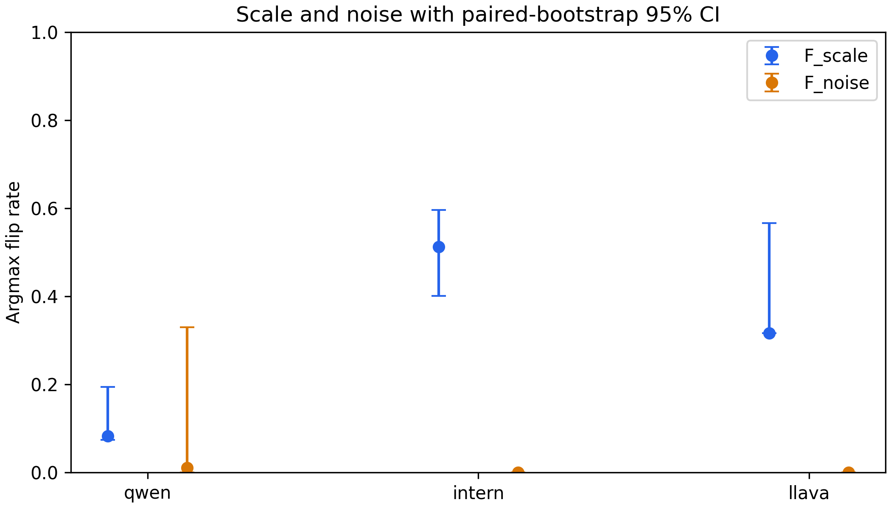

# ARP 多模态量尺审计与训练实验

截至2026-10-17，旧v1的B/C/D运行产物已完成计算与验收；新增独立7B路线B也已完成15次训练、16模型评测和完整五seed统计。原ARP protocol-v2阶段C仍未放行，独立实验不替代其科学门槛。大体积数据和训练产物在GitHub Release的Assets中。

**7B完整实验报告：** [Qwen2.5-VL-7B独立自蒸馏结果与分析](docs/results/protocol-v2-20261016/7B独立自蒸馏实验结果报告.md)。包含16模型四轴分数、15次训练显存/耗时/损失曲线、12项校正配对区间及过程验收。原始数据见[7B实验Release](https://github.com/Jerry-114514/Jerry-vibe-coding/releases/tag/arp-protocol-v2-20261016)。

**7B定位测量补充：** [坐标审计与补救方案](docs/results/protocol-v2-20261016/7b_grounding_recovery_plan.md)。CPU审计发现原图/处理器像素尺度混杂，原U定位增益暂不能解释为纯能力提升；原始分数保留，独立定位复测已登记。

**结果与交接：** [基于《大模型方案》的实验结果报告](docs/results/protocol-v2-20261016/大模型方案_实验结果报告_20261017.md) · [Markdown交接文档](docs/results/protocol-v2-20261016/大模型方案_实验交接文档_20261017.md)。7B定位复测正在运行；9B十五次训练已完成，但共同处理器像素校准未通过，正式评测尚未启动。[当前测量协议及修订](docs/results/protocol-v2-20261016/common_processor_pixel_execution.md)保留失败证据与停止规则。

## 查看实验结果

**新增补实验：** [protocol-v2总览与9B进展](docs/results/protocol-v2-20261016/README.md) · [必要原始产物Release](https://github.com/Jerry-114514/Jerry-vibe-coding/releases/tag/arp-protocol-v2-20261016) · [API教师与内存方案核查](docs/大模型方案_核查意见_20261016.md)。独立7B五seed实验已由用户单独授权并完成；原ARP主线及独立确认仍受其门槛约束。

| 需要的内容 | 入口 |
|---|---|
| B/C/D 完整结果、阶段状态与限制 | [最终结果总览](docs/results/final-20261016/README.md) |
| B：7 个基础模型四轴分数 | [基础模型 CSV](docs/results/final-20261016/base-model-scores.csv) |
| C：量尺等价类、稳定性与归因 | [Table 1](docs/results/final-20261016/table1-equivalence.csv) · [Table 2](docs/results/final-20261016/table2-stability.csv) · [Table 3](docs/results/final-20261016/table3-attribution.csv) |
| D：训练后结果 | [逐轴增益 JSON](docs/results/final-20261016/signed-gains.json) · [各量尺类增益 CSV](docs/results/final-20261016/table4-arm-gains.csv) |
| B/C/D 显存占用 | [显存报告和数据](docs/results/vram-20261016/README.md) |
| 逐题输出、教师缓存、LoRA、恢复状态、图片 | [完整实验 Release 下载](https://github.com/Jerry-114514/Jerry-vibe-coding/releases/tag/arp-formal-20261014) |
| 完整性和上传验收 | [计算产物验收](docs/results/final-20261016/final-verification.json) · [10,561 个必要文件备份核验](docs/results/final-20261016/github-backup-verification.json) |
| 下一轮研究设计 | [整体改进与补实验方案](docs/ARP_整体改进与补实验方案_20261016.md)（待执行） |

B 包含 118,300 条推理；D 的三个训练臂各完成 1,000 次实际更新、各 16,900 条训练后评测。A1/A2/U 的四轴原始增益之和分别为 +3.031、+2.714、+1.417 个百分点。这是单 seed 的点估计，不能据此宣称 A1 显著优于 A2；定位协议、量尺定义与平局效应等限制见结果总览和补实验方案。



下载完整数据时，请展开 Release 的 **Assets**，选择以 `arp-formal-20261014-20261016T004018Z.tar.gz` 命名的最终实验包（约 1.06 GB），并另取 `...20261016T004031Z.tar.gz` 最终显存包。自动生成的 **Source code (zip/tar.gz)** 只有 Git 文件，不包含这些实验附件。原始数据与权重从 AutoDL 直接上传，未下载到本地电脑。

仓库中的合成量尺演示与正式结果分开标注；真实交互结果为 [interactive-results.html](docs/results/final-20261016/interactive-results.html)，下载后可用浏览器打开。

---

## ARP 阶段 A：数据准备

工作目录：`D:\gpt data`。准备日期：2026-10-14。随机种子：`20261014`。

阶段 A 的 A1–A4 已完成，所有数据均为真实公开 benchmark。最终状态、文件数量及校验结果以 `data/validation_report.json` 为准。整个阶段不需要 GPU。

| 轴 | 冻结计分单位 | 推理输入行数 | 退化答题器 | 实测 c_a |
|---|---:|---:|---|---:|
| POPE | 9,000 | 9,000 | 全部回答 no | 0.500000 |
| 定位 | 2,400 | 2,400 | 图像中心框、训练框面积中位数 | 0.027917 |
| 一致性 | 800 原题 | 4,000 | 每个改写固定回答 A | 0.351250 |
| MMStar | 1,500 | 1,500 | 固定种子、实际选项均匀随机 | 0.260667 |
| 合计 | 13,700 | 16,900 | | |

### 已完成的产物

- A1：POPE random/popular/adversarial 各 3,000 题；RefCOCO、RefCOCO+、RefCOCOg 原始标注归档及训练/验证标注；MMStar 全量 1,500 题；MMBench 英文 dev 原始 4,329 行。
- A2：`tools/make_paraphrases.py`；`data/consistency/base_items.jsonl`、`items.jsonl`、`answer_keys.jsonl`、`templates.json`。
- A3：`data/manifest.jsonl`、`manifest.meta.json`、`experiment.lock.json`。冻结清单包含题干、答案键、原图尺寸、数据来源及重采样分组。
- A4：`tools/run_degenerate.py`；`data/baselines/per_item.jsonl`、`per_unit.jsonl`、`c_a.json`。已实际执行全部四个答题器。

COCO 2014 所需原图共 2,405 张；MMStar 和一致性轴所用内嵌图片共 2,300 张。合计 4,705 个本地图像文件、467,155,310 字节（约 445.5 MiB）。逐图 SHA256 见 `data/assets.sha256.jsonl`。

### 冻结协议

严格采用提供的论文卡第 2 页 M0/M1 的数据与计分定义。论文卡中的定位 floor 示例 0.02 仅是示例，实际实验使用本次逐题测得的 0.0279166667。

**POPE。** 使用原论文对应的 COCO POPE，而非后续 POPEv2。三种负例策略各保留全量 3,000 题，合并为一条能力轴，三种策略等权。每题按 yes/no 精确匹配计分。全部回答 no 在每种策略上均为 1,500/3,000。

**定位。** 使用 RefCOCO/UNC、RefCOCO+/UNC、RefCOCOg/UMD 的 val。原始验证集分别含 3,811/3,805/2,573 个 reference、10,834/10,758/4,896 条指代表达。每套数据按 `SHA256(seed:dataset:ref_id)` 排序，选 800 张不同图像上的 reference；每个 reference 采用 sent_id 最小的一条表达。原始全部验证标注已下载，正式清单使用预先固定的子集，图片仅下载子集所需原图。三套数据等权合并为定位轴。预测格式为原图像素坐标 `[x_min,y_min,x_max,y_max]`，按连续坐标面积计算 IoU，IoU ≥ 0.5 判对，不采用像素框的 `+1` 面积约定。

定位答题器只使用每套数据的 **train** reference 对应的唯一 ann_id，计算 `bbox_width * bbox_height` 的中位数。面积不是 segmentation area，也不是验证集统计量。中心矩形采用图像宽高比；若中位面积超过图像面积，面积截断至整幅图像面积。面积值、训练样本数及训练/验证对象不重叠核验见 `data/baseline_train_statistics.json`。三个子集分别为 22/800、22/800、23/800，总计 67/2,400。

**一致性。** 先将 MMBench 英文 dev 中同图、同题干、同选项集合的循环选项排列折叠为原题，并排除与 MMStar 图片字节相同的 4 条源记录。剩余 1,162 个候选原题中，按种子和原始 index 的 SHA256 选 800 题。每题使用 5 个固定的提问模板，保留原题语义、hint、选项顺序和答案键。模板是固定提示表达的变化，不调用语言模型生成自由改写。**五个改写必须全部答对，该原题才得 1 分。** 重复固定答案不按“回答一致”直接得分。固定 A 在 281/800 个原题上通过全部五个改写。

**MMStar。** 保留全部 1,500 题和官方答案键，不改写其题干。使用 `random.Random(20261014)`，按冻结 manifest 的顺序遍历，在每题实际存在的选项中均匀抽样。第 855 题实际只有 A/B/C 三个选项，其余题有四个选项；该题按 1/3 概率抽样。实测分数为 391/1,500，不将理论 0.25 直接用作 floor。

### 阶段 B/C 的数据接口

`manifest.jsonl` 每行是一条模型推理输入，必含：

```text
axis, item_id, image_path, question, answer_key
```

另外包含 `answer_type`、`width`、`height`、`dataset`、`split`、`bootstrap_unit` 等字段。`image_path` 是相对项目根目录的 POSIX 路径；在 Windows 和 Linux 均使用 `Path(project_root) / image_path` 加载。答案键只供评分，禁止拼入推理提示。

四个轴的名称固定为 `pope`、`grounding`、`consistency`、`mmstar`。基线 `per_item.jsonl` 包含逐输入的 `checkpoint, axis, item_id, raw_generation, parsed_answer, correct_bit, parse_fail_flag`，另附数据集、分组和定位 IoU。`per_unit.jsonl` 将一致性轴的 5 个输入折叠成 1 个原题计分单位。

阶段 B 应推理全部 16,900 行，再用 `tools/scoring.py` 的计分规则聚合。一致性轴的 bootstrap 必须重采样 800 个原题分组，保留组内所有 5 个改写；不能把 4,000 个改写当作 4,000 个独立题目。POPE 复用 500 张图片，定位的三个数据集也会共享部分 COCO 图片；`image_group` 字段供后续按图像聚类的敏感性分析使用。当前阶段未计算需要真实模型推理结果的 u_a。

### 来源和溯源

- POPE：[官方仓库](https://github.com/RUCAIBox/POPE)，`output/coco/coco_pope_{random,popular,adversarial}.json`。
- RefCOCO：[官方 REFER 仓库](https://github.com/lichengunc/refer)；原站失效后采用[官方仓库列出的归档方案](https://github.com/lichengunc/refer/issues/14#issuecomment-1258318183)。原始三个 ZIP 位于 `data/raw/refer/`，官方 Python 2 API 保留为 `refer.original.py`。
- COCO：[官方图片来源](https://cocodataset.org/#download)，原图下载地址为 `http://images.cocodataset.org/{train2014,val2014}/...`。全部逐图 URL 见 `data/image_download_plan.json`。
- MMStar：[作者发布数据](https://huggingface.co/datasets/Lin-Chen/MMStar)，冻结版本 `bc98d668301da7b14f648724866e57302778ab27`。
- MMBench：[英文 dev 数据镜像](https://huggingface.co/datasets/lmms-lab-encoder/MMBench)，冻结版本 `56ba1af8954932c4804bd3f522e05ed96e63b654`。
- RefCOCO 标注辅助镜像：[refcoco](https://huggingface.co/datasets/jxu124/refcoco)、[refcocoplus](https://huggingface.co/datasets/jxu124/refcocoplus)、[refcocog](https://huggingface.co/datasets/jxu124/refcocog)。已与原始 ZIP 核对所有 train/val 的 reference、逐字表达、原始 annotation 和图像元数据，共 137,097 条 reference，均完全一致；结果见 `data/refer_mirror_audit.json`。最终准备优先读取原始 ZIP。

`tools/refer_api.py` 是适配 Python 3/Windows 的 REFER 只读边界框 API 子集，支持 getRefIds/loadRefs/getRefBox，不依赖原 API 的 Python 2、掩膜扩展和可视化依赖。它直接读取原始 ZIP 中的 instances.json、refs(unc).p/refs(umd).p。

原始文件下载 URL 和 SHA256 见 `data/download_sources.json`、`data/refer_mirror_sources.json`。POPE 按下载快照的文件 SHA256 冻结；Hugging Face 文件同时固定仓库 revision 和文件 SHA256。`experiment.lock.json` 额外冻结代码、依赖版本、模板、统计量、基线结果和 manifest。

### 运行和复验

当前环境的依赖已安装。其他机器需要 Python 3.10+ 并安装 `requirements.txt` 中的依赖；实际运行环境为 Python 3.14.6。

在 PowerShell 中：

```powershell
Set-Location -LiteralPath 'D:\gpt data'
python tools/prepare_phase_a.py all
python -m unittest discover -s tests -v
```

一键命令复用已下载的完整文件和固定来源元数据，重建相同的题目选择、基线并复验；图片下载支持按文件断点续跑和重试。清单已冻结时，若重建内容发生变化，脚本会报错，避免覆盖同名实验。

单独操作：

```powershell
python tools/make_paraphrases.py
python tools/run_degenerate.py
python tools/prepare_phase_a.py validate
```

5 项评分单元测试覆盖 IoU 的 0.5 边界、无效框、中心框面积、一致性全对规则和缺失改写。完整验收还检查原始来源 SHA256、所有图片完整解码、尺寸、题号唯一性、答案键、边界框、5 改写分组、每轴最低题量、基线覆盖和 c_a 汇总一致性。完整重跑的 manifest 与两份逐题基线 SHA256 比较结果见 `data/reproducibility_report.json`。
