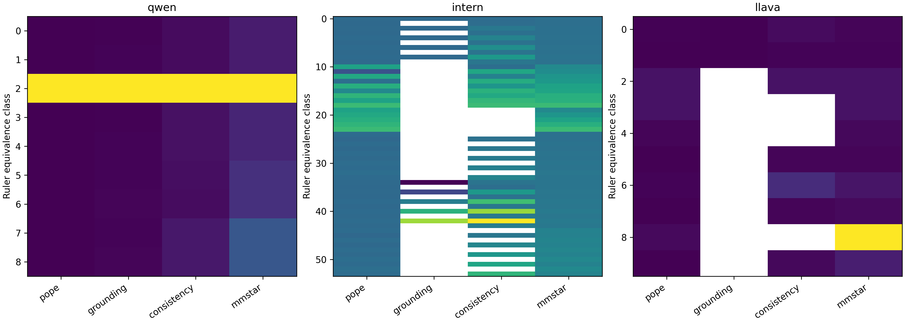

# B、C、D 最终实验结果与验收

2026-10-16：全部计算已完成，最终独立验收通过。数据包、原始日志和校验清单见 [GitHub Release](https://github.com/Jerry-114514/Jerry-vibe-coding/releases/tag/arp-formal-20261014)。

本页展示已完成的 **v1 原协议结果**；定义与统计设计的后续改进见 [补实验方案](../../ARP_整体改进与补实验方案_20261016.md)，补实验尚未执行。计算完成与备份完整，不代表所有研究主张已经得到验证。

## 直接查看结果

| 内容 | 可在线查看或下载的文件 |
|---|---|
| B：7 个模型的四轴分数 | [CSV 原始小数](base-model-scores.csv)；下方百分制表格 |
| C：120 设置及经验等价类映射 | [Table 1](table1-equivalence.csv) |
| C：稳定性、保持率与区间 | [Table 2](table2-stability.csv)；[完整 JSON](results.json) |
| C：坐标归因与对照 | [Table 3](table3-attribution.csv)；[原判定](analysis/gate.json)；[图像聚类敏感性判定](analysis-cluster/gate.json) |
| D：所有量尺类下的训练臂增益 | [Table 4](table4-arm-gains.csv)；[逐轴原始增益](signed-gains.json) |
| 交互浏览 | [真实结果 HTML](interactive-results.html)（下载后用浏览器打开；GitHub 文件页只显示源码） |
| 显存与验收 | [显存报告](../vram-20261016/README.md)；[B/C 重评分验收](bc-verification.json)；[最终独立验收](final-verification.json) |

## 完整实验数据与训练产物下载

体积较大的逐题账本、教师缓存、LoRA、优化器恢复状态和图片放在 Release 的 **Assets**，不在普通 Git 代码目录。GitHub 自动生成的 `Source code (zip/tar.gz)` 只包含 Git 文件，**不包含以下实验数据附件**。

| 附件 | 内容 | 大小 |
|---|---|---:|
| [最终完整实验包](https://github.com/Jerry-114514/Jerry-vibe-coding/releases/download/arp-formal-20261014/arp-formal-20261014-20261016T004018Z.tar.gz) | B/C/D 原始输出、分析、教师缓存、训练产物、冻结输入、训练图片和评测图片 | 1,064,822,655 字节，约 1.06 GB |
| [完整实验包逐文件清单](https://github.com/Jerry-114514/Jerry-vibe-coding/releases/download/arp-formal-20261014/arp-formal-20261014-20261016T004018Z-inventory.json) | 每个文件的路径、大小与 SHA256 | 约 2.23 MB |
| [最终显存完整附件](https://github.com/Jerry-114514/Jerry-vibe-coding/releases/download/arp-formal-20261014/arp-formal-20261014-20261016T004031Z.tar.gz) | 显存汇总、后期采样与原始证据 | 22,606 字节 |
| [显存附件逐文件清单](https://github.com/Jerry-114514/Jerry-vibe-coding/releases/download/arp-formal-20261014/arp-formal-20261014-20261016T004031Z-inventory.json) | 显存附件路径与 SHA256 | 4,484 字节 |

完整实验包 SHA256：`fcf9780dab9d9533072851e9ee2aa567d6926431e611d75d62d4700d9ab4ec68`。

显存附件 SHA256：`1b3b45ff87e2abf470491bcc1799d4a5a4af3aace5ce964543f50de5f9a42d86`。

2026-10-16 再次用 GitHub 实时附件大小及服务端 SHA256 核验，**10,561 个必要文件均被已上传的清单覆盖，缺失 0 个**。见 [备份核验记录](github-backup-verification.json)。历史阶段性附件继续保留，复现优先下载上面两份最终包。

| 阶段 | 已核验完成的内容 |
|---|---|
| B | 7 个模型各 16,900 条，共 118,300 条；无缺题或重复，完整性校验及逐题重评分通过 |
| C | 三个模型家族各 1,000 次配对重采样；120 组量尺映射、等价类、置信区间、植入检验和同质 floor 对照；正式判定 go |
| D2 | 3,545 条教师 top-50 logits 缓存，文件校验通过 |
| D3 | A1、A2、U 各 1,000 次实际优化器更新；非零 LoRA B 权重、最终 adapter 与恢复状态一致；N 为零更新对照 |
| D4 | A1、A2、U 各 16,900 条完整评测，共 50,700 条；逐题重评分及最终净增益表复算一致；N 复用未更新基座账本 |
| 最终汇总 | Table 1–4、图表、逐轴 signed components、验收记录及显存报告已生成 |

## B：基础模型分数

以下为百分制。解析失败按错误计分；定位分数同时受到格式与坐标契约影响，不宜单独解释为通用定位能力。

| 模型 | POPE | 定位 | 一致性 | MMStar |
|---|---:|---:|---:|---:|
| qwen3b | 87.478 | 66.750 | 81.000 | 54.333 |
| qwen7b | 87.678 | 67.625 | 84.125 | 62.067 |
| intern1b | 87.122 | 0.083 | 26.750 | 49.333 |
| intern2b | 89.844 | 0.208 | 30.125 | 56.333 |
| intern8b | 91.100 | 0.000 | 88.250 | 68.067 |
| llava05b | 75.622 | 0.000 | 22.625 | 27.600 |
| llava7b | 89.833 | 0.000 | 83.375 | 59.933 |

## C：原协议量尺审计图表

两图来自原运行导出。原 F 包含并列分摊效应；严格反转、平局与小分母诊断属于补实验方案中的待完成分析，不能将此图当作修正协议已验证的结果。[植入机制图](planted-boundary.png) 是构造检验，不是真实模型新增观测。

## 四轴增益

单位为百分点；最后一列是四轴变化之和，不是整体准确率，也不是四轴平均值。

| 训练臂 | POPE | 定位 | 一致性 | MMStar | 四轴增益之和 |
|---|---:|---:|---:|---:|---:|
| A1（推理轴，ScienceQA 独立训练代理） | +0.156 | 0 | +1.875 | +1.000 | +3.031 |
| A2（一致性轴） | +0.022 | +0.250 | +0.375 | +2.067 | +2.714 |
| U（混合） | +0.433 | -0.833 | +0.750 | +1.067 | +1.417 |
| N（不更新参数） | 0 | 0 | 0 | 0 | 0 |

以上为当前单次训练的完整评测点估计，不表示 A1 相对其他训练臂具有统计显著优势。

## 已知限制

- Qwen 视觉部分因已确认的 FP16 溢出而使用 FP32，语言部分保持 FP16；旧运行已归档，所有正式结果统一重跑，精度修正见实验协议。
- 定位轴受输出格式和坐标约定影响，InternVL 的解析失败率很高，不能将其得分直接解释为一般定位能力。
- C 的 go 由 InternVL、LLaVA 的分离结果支持；Qwen 单独的区间仍重叠。
- floor correction 主导翻转的原预测未获得支持；Qwen 同质 floor 负对照没有改变训练选臂排序。
- C 和早期 D2 没有历史整卡显存曲线。缺测指标未填写为零，也没有用后续采样冒充历史峰值。

## 验收文件

- [最终权重、优化器、评测及净增益核验](final-verification.json)
- [逐项完成审计](audit.json)
- [逐轴原始增益](signed-gains.json)
- [各量尺等价类净增益](table4-arm-gains.csv)
- [最终 B/C/D 显存报告](../vram-20261016/README.md)

复核工具为 `tools/verify_final.py`、`tools/verify_bc.py`、`tools/audit_experiment.py`；备份核验工具为 `tools/verify_backups.py`。
