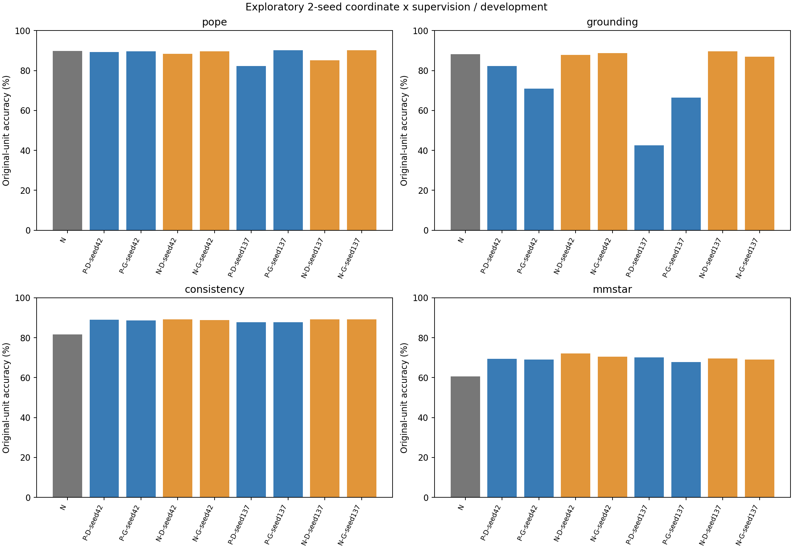
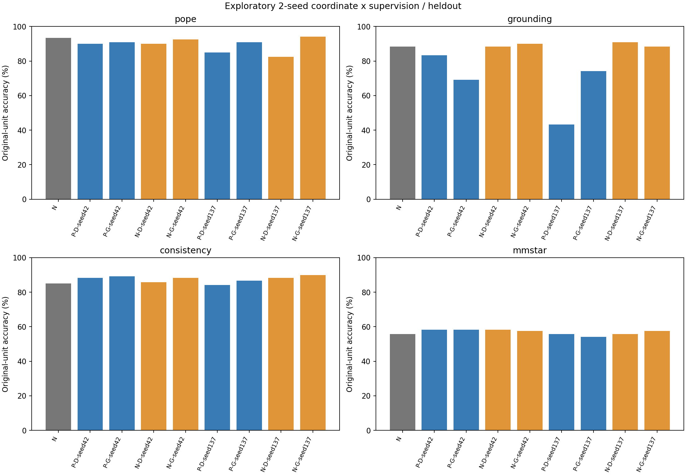
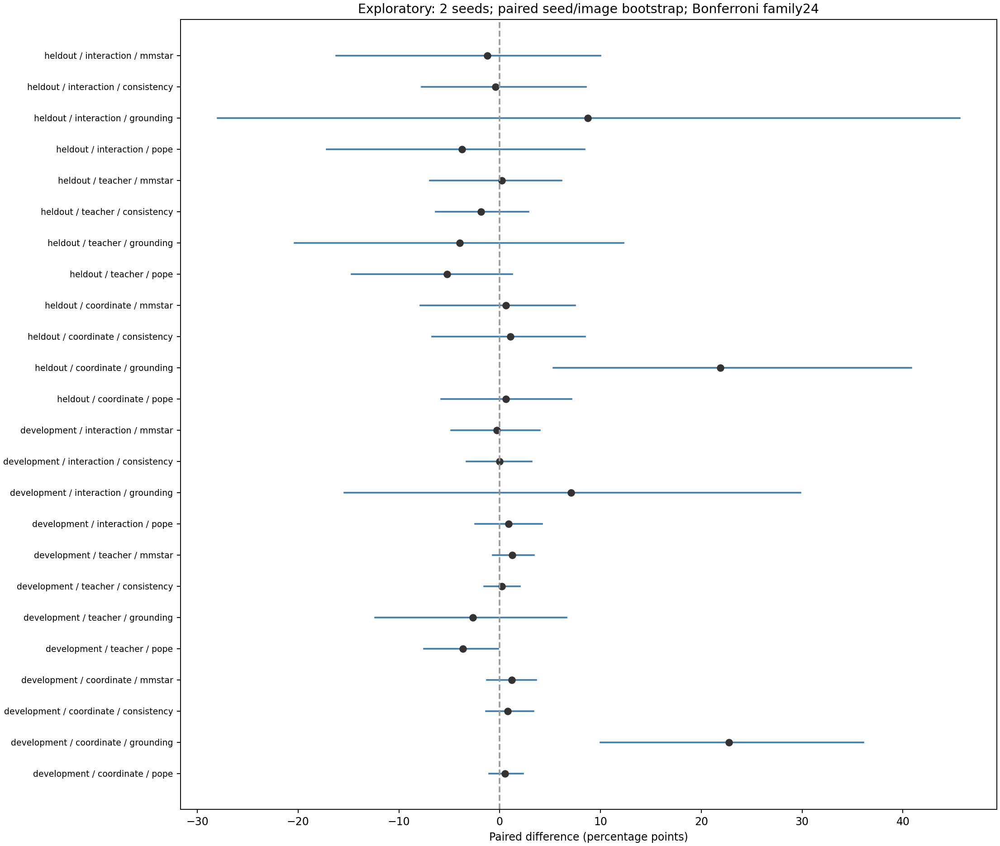
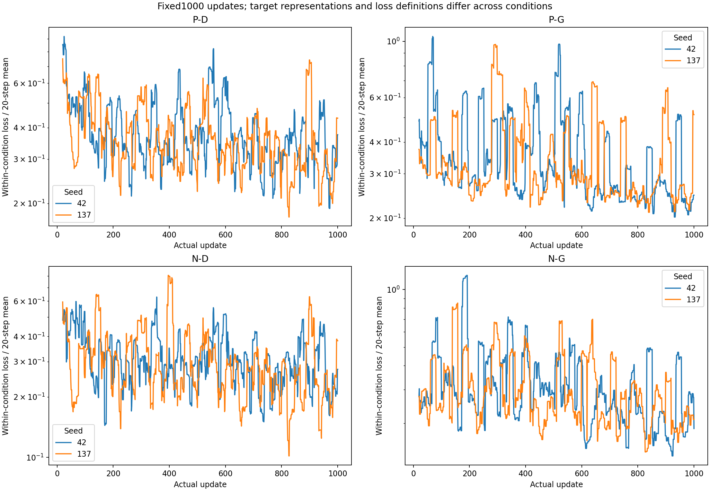

# 9B定位失稳：坐标表示×监督2×2探索性对照

共8个固定1000步端点、2个seed，其中两个P-D为历史端点，新增6,000步。所有结果保留，不选择最优seed或检查点。
旧16模型及原12项比较结果不改写；本轮24项探索性比较单独报告。只有两个seed，不把区间解释为广泛训练稳定性证明。

## development

| 模型 | POPE | 定位 | 一致性 | 推理轴 |
|---|---:|---:|---:|---:|
| N | 89.867% | 88.250% | 81.625% | 60.667% |
| P-D-seed42 | 89.244% | 82.333% | 89.000% | 69.400% |
| P-G-seed42 | 89.656% | 70.917% | 88.625% | 69.000% |
| N-D-seed42 | 88.378% | 87.917% | 89.125% | 72.067% |
| N-G-seed42 | 89.667% | 88.792% | 88.750% | 70.467% |
| P-D-seed137 | 82.344% | 42.583% | 87.750% | 70.133% |
| P-G-seed137 | 90.100% | 66.458% | 87.750% | 67.733% |
| N-D-seed137 | 85.144% | 89.583% | 89.250% | 69.600% |
| N-G-seed137 | 90.233% | 87.000% | 89.250% | 69.000% |

| 因素 | 轴 | 差值pp | 24项校正区间pp |
|---|---|---:|---|
| coordinate | pope | +0.519 | [-1.045, 2.295] |
| coordinate | grounding | +22.750 | [9.988, 36.066] |
| coordinate | consistency | +0.812 | [-1.378, 3.358] |
| coordinate | mmstar | +1.217 | [-1.253, 3.619] |
| teacher | pope | -3.636 | [-7.501, -0.138] |
| teacher | grounding | -2.687 | [-12.343, 6.631] |
| teacher | consistency | +0.188 | [-1.534, 2.006] |
| teacher | mmstar | +1.250 | [-0.672, 3.386] |
| interaction | pope | +0.894 | [-2.429, 4.189] |
| interaction | grounding | +7.083 | [-15.398, 29.817] |
| interaction | consistency | +0.000 | [-3.305, 3.174] |
| interaction | mmstar | -0.300 | [-4.800, 4.000] |

## heldout

| 模型 | POPE | 定位 | 一致性 | 推理轴 |
|---|---:|---:|---:|---:|
| N | 93.333% | 88.333% | 85.000% | 55.833% |
| P-D-seed42 | 90.000% | 83.333% | 88.333% | 58.333% |
| P-G-seed42 | 90.833% | 69.167% | 89.167% | 58.333% |
| N-D-seed42 | 90.000% | 88.333% | 85.833% | 58.333% |
| N-G-seed42 | 92.500% | 90.000% | 88.333% | 57.500% |
| P-D-seed137 | 85.000% | 43.333% | 84.167% | 55.833% |
| P-G-seed137 | 90.833% | 74.167% | 86.667% | 54.167% |
| N-D-seed137 | 82.500% | 90.833% | 88.333% | 55.833% |
| N-G-seed137 | 94.167% | 88.333% | 90.000% | 57.500% |

| 因素 | 轴 | 差值pp | 24项校正区间pp |
|---|---|---:|---|
| coordinate | pope | +0.625 | [-5.813, 7.143] |
| coordinate | grounding | +21.875 | [5.328, 40.855] |
| coordinate | consistency | +1.042 | [-6.699, 8.475] |
| coordinate | mmstar | +0.625 | [-7.889, 7.500] |
| teacher | pope | -5.208 | [-14.706, 1.250] |
| teacher | grounding | -3.958 | [-20.339, 12.285] |
| teacher | consistency | -1.875 | [-6.356, 2.868] |
| teacher | mmstar | +0.208 | [-6.933, 6.127] |
| interaction | pope | -3.750 | [-17.164, 8.403] |
| interaction | grounding | +8.750 | [-27.986, 45.635] |
| interaction | consistency | -0.417 | [-7.735, 8.539] |
| interaction | mmstar | -1.250 | [-16.216, 10.000] |

## 解释边界

坐标主效应=(N-D+N-G-P-D-P-G)/2；教师主效应=(P-D+N-D-P-G-N-G)/2；交互=(N-D-N-G)-(P-D-P-G)。
表示变更包含由单位改变产生的数值文本与token长度变化，不能声称只隔离空间能力。GT-only保留完整单CE权重。
复核集每轴120原题，总960提示，来自既有去重confirm角色中未见的单图子集；推理为MMMU选择题代理，不能冒称MMStar全量或完整MMMU。
旧数据上的排错发生在结果观察之后；独立子集也只有两个训练seed。未有人工作为原ARP所要求的定位盲审，原ARP阶段C仍未放行。
历史/新端点存在运行时序差异，坐标、教师与其他优化机制的完整因果归因仍有局限。区间跨0不证明等效。

## 训练过程与资源

不同目标表示和GT-only/双CE之间的损失量级不可直接当作能力排名；曲线用于各条件内健康检查。

| 条件与seed | 更新 | 步骤耗时分钟 | reserved GB | 最后损失 |
|---|---:|---:|---:|---:|
| P-D-seed42 | 1000 | 15.64 | 21.095 | 0.00933792 |
| P-G-seed42 | 1000 | 17.89 | 20.804 | 0.000132305 |
| N-D-seed42 | 1000 | 34.12 | 21.030 | 0.0310675 |
| N-G-seed42 | 1000 | 17.80 | 20.709 | 0.000455293 |
| P-D-seed137 | 1000 | 15.53 | 20.800 | 2.56297e-05 |
| P-G-seed137 | 1000 | 16.73 | 20.525 | 0.000728981 |
| N-D-seed137 | 1000 | 33.06 | 21.534 | 0.000210375 |
| N-G-seed137 | 1000 | 21.90 | 21.250 | 5.54321e-06 |

步骤耗时不含加载、保存与上传；原始逐步损失、梯度、显存、耗时、恢复状态及SHA都归档Release。

