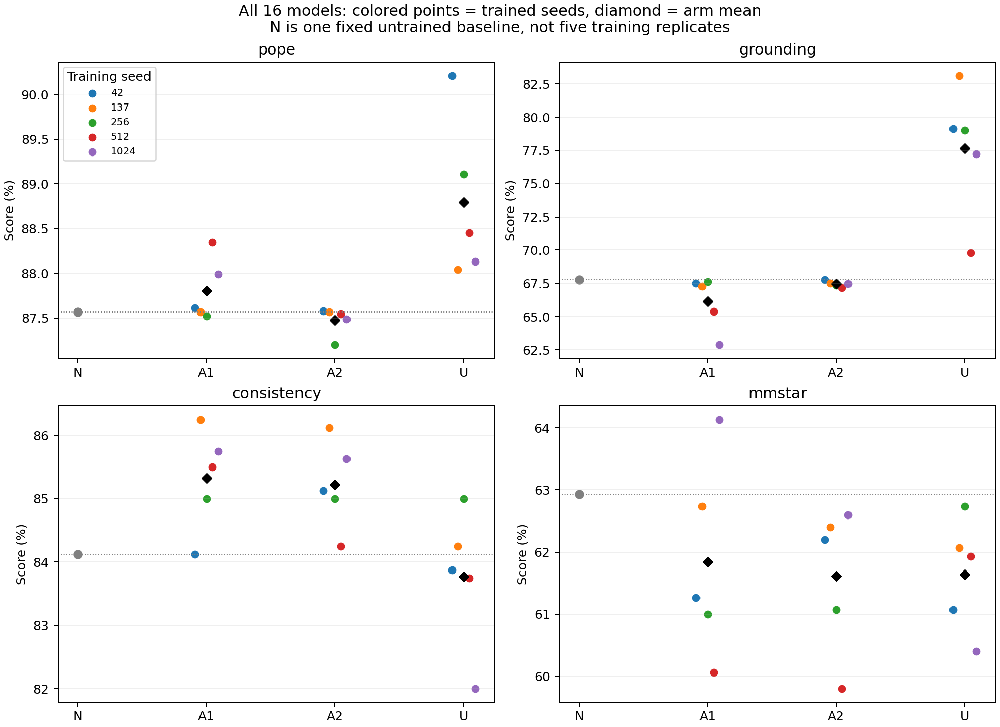
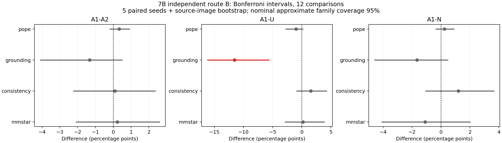

# 独立7B：最终图表与校正区间结论

16模型全部完成，每模型16,900提示；15次训练均固定1,000更新。全部五个seed配对，12项比较按Bonferroni校正。

教师与学生均为Qwen2.5-VL-7B，双CE序列蒸馏。A1=mmstar推理代理，A2=consistency，U=四轴等比例，N=不更新。

| 模型 | pope | grounding | consistency | mmstar |
|---|---:|---:|---:|---:|
| N-seed42 | 87.567% | 67.792% | 84.125% | 62.933% |
| A1-seed42 | 87.611% | 67.500% | 84.125% | 61.267% |
| A2-seed42 | 87.578% | 67.792% | 85.125% | 62.200% |
| U-seed42 | 90.211% | 79.125% | 83.875% | 61.067% |
| A1-seed137 | 87.567% | 67.292% | 86.250% | 62.733% |
| A2-seed137 | 87.567% | 67.500% | 86.125% | 62.400% |
| U-seed137 | 88.044% | 83.125% | 84.250% | 62.067% |
| A1-seed256 | 87.522% | 67.625% | 85.000% | 61.000% |
| A2-seed256 | 87.200% | 67.375% | 85.000% | 61.067% |
| U-seed256 | 89.111% | 79.000% | 85.000% | 62.733% |
| A1-seed512 | 88.344% | 65.375% | 85.500% | 60.067% |
| A2-seed512 | 87.544% | 67.167% | 84.250% | 59.800% |
| U-seed512 | 88.456% | 69.792% | 83.750% | 61.933% |
| A1-seed1024 | 87.989% | 62.875% | 85.750% | 64.133% |
| A2-seed1024 | 87.489% | 67.458% | 85.625% | 62.600% |
| U-seed1024 | 88.133% | 77.250% | 82.000% | 60.400% |

| 对比 | 轴 | 差值（百分点） | 校正区间（百分点） | 区间结论 |
|---|---|---:|---|---|
| A1-A2 | pope | 0.331 | [-0.180, 0.906] | 区间包含0，差异证据不足 |
| A1-A2 | grounding | -1.325 | [-4.092, 0.485] | 区间包含0，差异证据不足 |
| A1-A2 | consistency | 0.100 | [-2.225, 2.357] | 区间包含0，差异证据不足 |
| A1-A2 | mmstar | 0.227 | [-2.069, 2.589] | 区间包含0，差异证据不足 |
| A1-U | pope | -0.984 | [-2.724, 0.184] | 区间包含0，差异证据不足 |
| A1-U | grounding | -11.525 | [-16.157, -5.648] | 右臂更高，区间排除0 |
| A1-U | consistency | 1.550 | [-0.858, 4.252] | 区间包含0，差异证据不足 |
| A1-U | mmstar | 0.200 | [-2.831, 3.820] | 区间包含0，差异证据不足 |
| A1-N | pope | 0.240 | [-0.343, 0.887] | 区间包含0，差异证据不足 |
| A1-N | grounding | -1.658 | [-4.572, 0.465] | 区间包含0，差异证据不足 |
| A1-N | consistency | 1.200 | [-1.052, 3.646] | 区间包含0，差异证据不足 |
| A1-N | mmstar | -1.093 | [-4.084, 2.002] | 区间包含0，差异证据不足 |

按组归纳：
- A1-A2：四轴校正区间均包含0，当前实验的差异证据不足。
- A1-U：以下校正区间排除0：grounding（A1低于U）；其余轴证据不足。
- A1-N：四轴校正区间均包含0，当前实验的差异证据不足。

校正族固定为3组对比×4轴。区间由10,000次训练seed与来源图像簇配对bootstrap生成；一致性五改写先合并原题。只有5个训练seed，尾部分位数存在Monte Carlo误差，因此整体95%覆盖是名义近似。

包含0不证明相等；排除0只作为本独立实验的探索性差异证据，不虚构p值。多重比较校正是在部分开发结果出现后按用户要求补充，不冒充事前确认性检验。原ARP阶段C仍未放行。

黑色菱形为五seed均值，彩色点为各次训练；N为唯一未训练基线。训练损失、显存和耗时见同Release的训练汇总。PNG供快速查看，PDF可独立导出。
