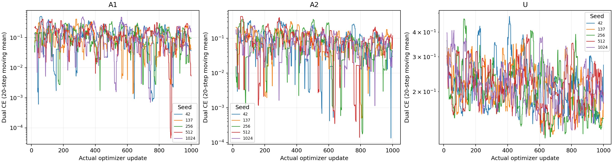

# 独立7B：15次训练完成

固定3臂×5seed×1,000次真实更新，未临时追加预算。耗时为逐步处理总和，不含装载/保存/备份/排队；账单应按实际开机时长。

| 臂 | seed | 秒/步 | 更新耗时(分钟) | reserved GB | 末步损失 |
|---|---:|---:|---:|---:|---:|
| A1 | 42 | 0.568 | 9.46 | 20.703 | 0.000164947 |
| A2 | 42 | 0.530 | 8.83 | 22.028 | 4.64913e-06 |
| U | 42 | 0.569 | 9.49 | 20.479 | 1.66921 |
| A1 | 137 | 0.560 | 9.33 | 21.901 | 0.000865528 |
| A2 | 137 | 0.527 | 8.79 | 20.319 | 5.37598e-05 |
| U | 137 | 0.569 | 9.49 | 21.590 | 3.4093e-05 |
| A1 | 256 | 0.561 | 9.36 | 22.496 | 0.0240991 |
| A2 | 256 | 0.525 | 8.75 | 21.240 | 0.000136149 |
| U | 256 | 0.567 | 9.45 | 24.547 | 2.27685e-05 |
| A1 | 512 | 0.573 | 9.55 | 21.135 | 6.40901e-05 |
| A2 | 512 | 0.527 | 8.79 | 22.815 | 1.3961 |
| U | 512 | 0.564 | 9.39 | 21.183 | 0.897953 |
| A1 | 1024 | 0.563 | 9.38 | 22.645 | 0.00320066 |
| A2 | 1024 | 0.528 | 8.80 | 21.542 | 1.47022e-05 |
| U | 1024 | 0.569 | 9.48 | 22.481 | 0.297462 |

该报告不将训练完成等同于完整评测完成；逐题评测及配对区间另行更新。
