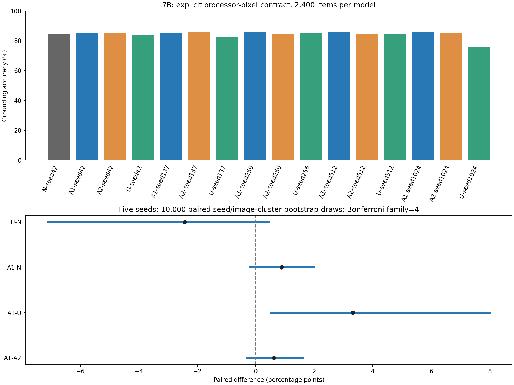
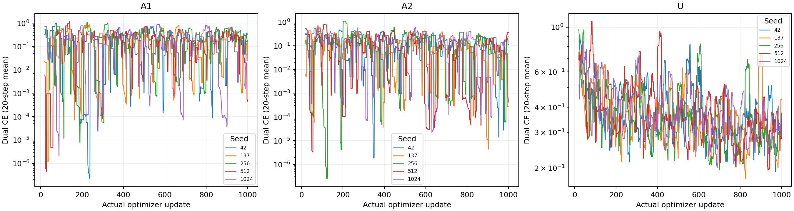

# 基于《大模型方案》的实验结果报告

> **最新状态：2026-10-18 12:28 北京时间。v4校准已失败停止（13/16模型、340/400条）；正式评测未启动。N为89%，A1-seed512出现20次长度截断、11次解析失败。CPU定位到tokenizer与默认生成EOS不一致；原始失败及900秒预算保留，不自动重跑。详见[停止报告与修复规格](9b_v4_calibration_stop_and_eos_diagnosis.md)。**

更新日期：2026-10-18；状态快照：北京时间 **2026-10-18 11:04:19**。文件名保留首次交付日期。这是阶段性结果报告，原ARP全部补实验尚未完成。配套[实验交接文档](大模型方案_实验交接文档_20261017.md)。

## 1. 依据、研究问题与执行变更

依据仓库归档的[用户版《大模型方案》](../../references/大模型方案_用户修订_20261016.md)，结合用户后续明确授权的执行变更：4090释放后统一使用RTX 5090；阶段C未放行时先运行独立路线B；完成7B自蒸馏后接力9B学生与122B API教师；最新批准不重训、先统一定位测量。

方案原定P1-4为7B学生加122B教师。**实际完成的7B是7B教师/7B学生自蒸馏；9B是9B学生/122B教师的独立扩展。二者均不能冒充原定P1-4确认性实验。** P1-2应为3B学生/7B教师、原KL协议，也不能用7B自蒸馏替代。

原方案中的估价、商业模型参数量映射和文献条目属于参考材料，本报告不将其直接当成已验证事实；费用采用用户指定的5090单价2.70元/小时，API费用未取得账单时不编造金额。

## 2. 方案逐项落实情况

| 方案项目 | 当前实证 | 完成边界 |
|---|---|---|
| P0-1 公式核对 | [审计](p0/formula_audit.md)、[新旧表](p0/analysis_v1_vs_v2.csv)已输出 | 旧数据探索性重算，不是新独立确认 |
| P0-2 平局/反转/分母 | [敏感性及guard表](p0/tie_and_guard_report.csv)已输出 | 不将定义性平局当作严格翻转 |
| P0-3 全120设置 | [120设置×4臂](p0/arm_gains_all_120.csv)、[共同题集](p0/arm_common_support.csv)已输出 | 旧训练结果的补分析 |
| P0-4 定位测量审计 | 7B全16模型旧输出CPU审计完成；明确提示的GPU复测已完成并归档 | 双人独立盲审未完成；9B共同契约校准失败 |
| P1-1 独立确认集 | 尚无全部冻结并验收完成的证据 | 当前16,900提示是既有开发基准，不能称独立确认集 |
| P1-2 3B←7B KL桥接 | 尚未完成15次原协议桥接实验 | 最小工程预检不能替代正式桥接 |
| P1-3 扩展阶梯及§4.5精度桥接 | 精确3B/7B API上次403；商业审计暂停于1,365条 | 四轴严格差异<0.005未获证明，不能合并阶梯 |
| P1-4 原定7B←122B | 原ARP阶段C未放行，原主线未完成 | 独立7B与9B结果分别列出，不改名充当主线 |
| P2-1 第二家族、P2-2机制消融 | 尚无完整验收结果 | 不声称序列CE优于KL或跨家族泛化 |
| §12 存储与可复核性 | 冻结配置、缓存、日志、适配器、原始输出及Release校验链已建设 | 新复测逐模型归档，未完成部分不标记交付完成 |

原C的[当前判定](p0/gate.json)为`decision=indeterminate, formal=false, training_allowed=false`。工程成功不解除该科学门槛。

## 3. 独立7B自蒸馏：已完成的原轮结果

Qwen2.5-VL-7B-Instruct固定同一教师/学生检查点；BF16语言注意力和MLP LoRA，r=16、alpha=32、lr=1e-4、micro-batch=1、梯度累积1、梯度裁剪1.0。双CE为0.5真实答案CE+0.5教师回答CE；虽然保留top-50缓存，本实验KL权重为0。

A1使用mmstar轴的ScienceQA训练代理，A2使用consistency，U四轴等比例，N不更新。训练池3,545提示；全量EOS证据已核验。seed固定42/137/256/512/1024，每臂每seed固定1,000次真实更新。五项工程验收通过，A1最小循环第50步退出后从51步恢复至100步。完整方法和逐seed结果见[7B详报](7B独立自蒸馏实验结果报告.md)。

15次训练、15,000更新及原轮16×16,900=270,400条评测已完成。下表是五seed均值，N只有一个未训练基线；均为百分比，**定位列保留为旧测量结果，不作纯能力解释**。

| 臂 | POPE | 定位：旧计分 | 一致性 | MMStar |
|---|---:|---:|---:|---:|
| N | 87.567 | 67.792 | 84.125 | 62.933 |
| A1 | 87.807 | 66.133 | 85.325 | 61.840 |
| A2 | 87.476 | 67.458 | 85.225 | 61.613 |
| U | 88.791 | 77.658 | 83.775 | 61.640 |

原轮五seed配对seed/图像簇bootstrap，10,000次重采样，3组×4轴共12项Bonferroni校正；A1−A2、A1−N的四轴区间均包含0。唯一排除0的是**旧定位口径**A1−U：−11.525个百分点，校正区间[−16.157,−5.648]。由于定位单位混杂，不能据此主张U定位能力提高；含该轴的宏均值或G_floor也须重新审视。区间跨0表示证据不足，不表示已证明相等。

纯训练更新2.306小时，折算6.23元；原轮纯生成15.803小时，折算42.67元；合计约48.89元。最高训练reserved为24.547GB/22.861GiB，原轮评测最高20.122GB/18.740GiB。费用不含缓存构建、模型装载、保存、上传、排队及其他开机时间，不能当作账户总账单。

## 4. 测量审计：目前最关键的发现

原始输出按预先固定的不同坐标契约作CPU诊断时，7B N从原图像素口径67.792%变为处理器像素映射口径85.500%，U均值则从77.658%变为73.558%。这是单位/格式混杂的证据，**不是可以选择较高分替换主分的理由**；旧提示要求、模型原生格式、训练目标的交互尚未分离。见[全16模型CPU审计](7b-grounding-cpu-report.md)。

最新注册共同映射为：`x_orig=x_proc×W_orig/W_proc`、`y_orig=y_proc×H_orig/H_proc`，与原图标注计算IoU≥0.5；每条断言处理器实际网格。禁止按GT、训练臂或数值大小自动猜单位。

7B新提示要求“四个数”，第一版JSON-only解析器错误拒绝了严格CSV输出。为此在重新计分前发布纯语法修订：所有16模型统一接受既有JSON格式及严格四数CSV，不改变坐标值、单位、样本或IoU。保留原100条及旧协议，不新增生成。相同N前100条在修订后为**80%准确率、2次解析失败**，恰好达到冻结门槛≥80%、≤5次失败；属于事后测量修订，须披露，不能表述为首次协议直接通过。

快照时7B新定位已生成 **38,400/38,400** 条，完整16模型及五seed终局区间已完成，见下方终局分析。固定GPU预算截止为UTC `2026-10-18T03:42:49.643461+00:00`（北京时间10月18日11:42:49），未因语法修订重置。新复测报告A1−A2、A1−U、A1−N及U−N，独立4项Bonferroni族，不与原12项混成事前检验。

新契约下已完成的逐模型结果如下；每训练臂五seed全部保留，显著性依据下方校正配对区间。

| 模型 | 已完成定位题 | 新契约定位分 | 解析失败 |
|---|---:|---:|---:|
| N-seed42 | 2,400 | 84.708% | 58 |
| A1-seed42 | 2,400 | 85.417% | 11 |
| A2-seed42 | 2,400 | 85.125% | 16 |
| U-seed42 | 2,400 | 83.833% | 20 |
| A1-seed137 | 2,400 | 85.292% | 14 |
| A2-seed137 | 2,400 | 85.500% | 15 |
| U-seed137 | 2,400 | 82.667% | 60 |
| A1-seed256 | 2,400 | 85.667% | 1 |
| A2-seed256 | 2,400 | 84.667% | 10 |
| U-seed256 | 2,400 | 84.792% | 19 |
| A1-seed512 | 2,400 | 85.500% | 4 |
| A2-seed512 | 2,400 | 84.208% | 22 |
| U-seed512 | 2,400 | 84.375% | 10 |
| A1-seed1024 | 2,400 | 86.083% | 9 |
| A2-seed1024 | 2,400 | 85.375% | 12 |
| U-seed1024 | 2,400 | 75.708% | 258 |

### 统一契约复测终局：五seed与四项校正

16模型、38,400条已于北京时间10月18日05:34完成并归档，独立CPU图表收尾同分钟通过。N定位84.708%；五seed均值A1为85.592%、A2为84.975%、U为82.275%。

| 比较 | 差值：百分点 | 四项Bonferroni校正区间：百分点 | 区间排除0 |
|---|---:|---|---|
| A1-A2 | +0.617 | [-0.302, 1.603] | 否 |
| A1-U | +3.317 | [0.529, 8.013] | 是 |
| A1-N | +0.883 | [-0.207, 1.980] | 否 |
| U-N | -2.433 | [-7.110, 0.452] | 否 |

只有A1−U校正区间排除0；A1相对N、A2均未证明显著提升。U−N点估计为负但区间跨0，也不能宣称U显著退化。旧计分中U高于A1的方向没有在新明确提示/共同单位下保留，说明旧定位优势不稳健；不能把这项事后测量修订写成原ARP确认性结论，也不能单独断言所有差异仅由格式造成。

U-seed1024有258/2,400次解析失败，定位75.708%；该异常seed保留在五seed均值和区间中，没有根据结果剔除。解析/指令遵循与空间定位仍存在交互，当前不是纯定位能力隔离实验。

新复测纯生成合计5.607小时，按2.70元/小时折算约15.14元，不含装载、保存、上传及等待。全部模型评测均无优化器、无梯度。

[全部16模型与区间](7b-processor-final/report.md)、[统计JSON](7b-processor-final/results.json)、[独立38,400行核验](7b-processor-final/final-report/verification.json)、[图表PDF](7b-processor-final/final-report/grounding-final.pdf)。

## 5. 独立9B←122B：15次训练完成，正式评测未放行

学生为官方Qwen3.5-9B，教师为Qwen3.5-122B-A10B API；从3,545训练池得到3,540条可用教师回答，另5条因供应方图片检查按来源组隔离，不能称完整3,545条全部成功。已完成前缀未重复请求。API文本目标不是top-50 logits，也不以`finish_reason=stop`冒充原始EOS token证据。

9B最小循环五项工程检查通过；之后15次固定1,000步训练全部完成，共15,000更新，完成时间北京时间10月17日22:07:22。端点是固定第1,000步，没有根据结果加训或选最好检查点。

| 臂 | seed | 秒/步 | 纯更新分钟 | reserved GB | 第1,000步损失 |
|---|---:|---:|---:|---:|---:|
| A1 | 42 | 0.949 | 15.81 | 20.544 | 0.00123037 |
| A2 | 42 | 0.923 | 15.39 | 20.986 | 7.58142e-05 |
| U | 42 | 0.939 | 15.64 | 21.095 | 0.00933792 |
| A1 | 137 | 0.949 | 15.81 | 20.529 | 0.000206313 |
| A2 | 137 | 0.932 | 15.53 | 21.047 | 5.36442e-07 |
| U | 137 | 0.932 | 15.53 | 20.800 | 2.56297e-05 |
| A1 | 256 | 0.950 | 15.83 | 20.573 | 0.56931 |
| A2 | 256 | 0.947 | 15.78 | 20.978 | 0.0114619 |
| U | 256 | 0.939 | 15.65 | 20.860 | 5.64425e-05 |
| A1 | 512 | 0.951 | 15.85 | 20.523 | 0.000198333 |
| A2 | 512 | 0.933 | 15.55 | 20.758 | 0.000255252 |
| U | 512 | 0.936 | 15.59 | 20.913 | 0.101096 |
| A1 | 1024 | 0.946 | 15.76 | 20.516 | 6.65762e-05 |
| A2 | 1024 | 0.941 | 15.69 | 20.942 | 7.39092e-06 |
| U | 1024 | 0.941 | 15.69 | 21.104 | 0.00188248 |

纯更新合计 **3.919小时，约10.58元**；reserved最高 **21.104GB/19.654GiB**。训练健康检查确认两路CE与梯度有限、更新数及导出匹配；但最大裁剪前梯度范数为 **768.76**，使用1.0裁剪，因此不能声称全程没有梯度尖峰。末步损失是单样本端点，不是验证集均值，也不证明泛化能力。详见[训练数值](9b-training-final/training-results.json)、[健康核验](9b-training-final/training-health.json)。

9B共同处理器像素契约的N校准100条仅**1%准确率、95次解析失败**，未达到≥80%及≤5次失败，已停止；**正式16模型评测为0/16，没有9B正式四轴结论或多seed区间**。严格CSV语法也不能修复该单位问题。同一批输出按固定0–1000解释的CPU事后诊断为86%、0次失败，只支持单位不一致诊断，不能替换注册分数或据此放行。见[失败原证据](handoff-evidence-20261017/9b-failed-processor-calibration.json)。

9B的15分钟原校准绝对预算已截止，不重置，不反复修改提示追求80%。可讨论另立“家族原生前端→统一处理器像素→原图”的协议，但必须在新推理前固定四臂校准与独立预算；目前该方案未执行。

## 6. 对研究假设的结论与限制

1. 已验证单卡完整多臂、多seed双CE蒸馏、保存/加载、恢复及逐题归档流程可运行；不等于原ARP量尺选轴因果命题成立。
2. 7B现有证据未证明A1优于A2或N；旧U定位优势存在测量混杂，统一契约复测后旧优势未保留，当前仅A1高于U的四项校正区间排除0，不能据旧优势写论文主结论。
3. 9B训练完成但测量未通过，暂不能判断122B教师带来的能力收益。
4. 两轮同时改变学生代际/容量、教师、tokenizer/视觉处理器及可用训练池，不能将差异单独归因于7B→9B容量变化或教师规模。
5. 当前结果主要来自既有开发基准，未完成独立确认、同检查点API桥接、双人盲审及有效阶段C；不能声称P0–P2全部完成、商业阶梯等于精确参数阶梯或ARP主线已验证。

## 7. 数据交付、下一步与证据身份

7B原轮3,738/3,738必要文件的交付覆盖已核验，缓存、适配器、恢复链、逐步日志及原始评测见[7B Release](https://github.com/Jerry-114514/Jerry-vibe-coding/releases/tag/arp-protocol-v2-20261016)。9B缓存、训练适配器、恢复链及必要过程见[9B Release](https://github.com/Jerry-114514/Jerry-vibe-coding/releases/tag/arp-9b-122b-20261017)。新7B定位复测逐模型核对2,400唯一ID、SHA和服务器归档后续跑；尚未生成的结果不能视作已上传。

快照时数据盘空闲19.09GiB，系统盘6.75GiB，DiskGuard运行。7B复测、独立4项区间和图表均已交付；9B保留失败记录，另行固定可审阅的新接口校准；原ARP八项前置工作详见[执行计划](route_b_execution_plan.md)。执行入口、监控与恢复注意事项均在[交接文档](大模型方案_实验交接文档_20261017.md)。

| 证据文件 | SHA256 |
|---|---|
| `大模型方案_用户修订_20261016.md` | `4060c0b95fecca2735babf8661dd40df18acba59e3238f6ba0ff071bfe44329e` |
| `7b-active-processor-protocol.json` | `a99a9a430aa20ed33e639d2a734a73821e3af0fd2f5bd52a29c1df9b84599108` |
| `7b-csv-schema-amendment.json` | `1a0500616a60cf502c2fe4b334526f6f71ce30e69d241ebd16e85ea82c78a78f` |
| `9b-processor-pixel-protocol.json` | `9238274aa336d3b3255e2d89e5d709d8798bd818e9ddb7ce957659e9860bcf65` |
| `training-results.json` | `8a43816779148a26363729b7db02da60820f559cfae04d716d7cb9096e57667f` |

本报告只反映上述时间快照；活动任务以远程完成标记、实际行数与独立验收为准。
