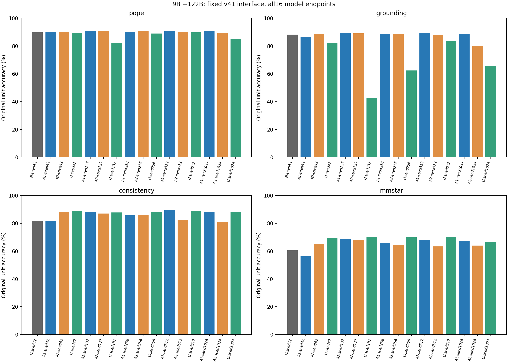
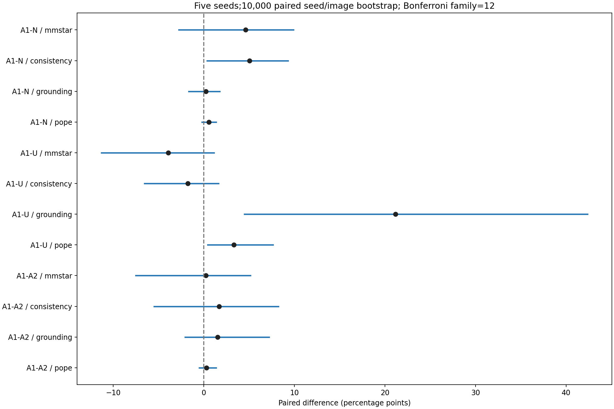

# 大模型方案补实验详尽报告：7B复测、9B终局与定位退化诊断

> 报告日期：2026-10-19；状态证据截至北京时间 2026-10-19 16:45:21。9B正式结果为完整五seed终局；修复实验仍在运行。本报告不替换历史失败记录或冻结协议。

## 1. 核心结论

9B独立实验已完成15次训练、16个模型的全部270,400条推理、完整性校验及GitHub Release归档。正式评测交付完成于北京时间 2026-10-19 15:08:21。原生坐标前端与EOS修复后，可以得到可复核的四轴分数；工程跑通不等于原ARP假设得到确认。

预先固定的A1−A2、A1−U、A1−N三组×四轴，共12项比较中，名义整体95%的Bonferroni校正bootstrap区间有3项不跨零：A1−N一致性、A1−U的POPE与定位。其余9项不能拒绝零差异，也不能据此认定等效。

最重要的正向结果是A1相对未训练N的一致性平均提升5.05个百分点；最重要的风险是U混合训练定位平均下降20.91个百分点，且所有五个seed均低于N。不能将本实验表述为“全面能力提升”或“更大教师必然更好”。

## 2. 方案依据、执行范围与阶段边界

依据[用户大模型方案](../../references/大模型方案_用户修订_20261016.md)、[执行修订](../../大模型方案_落地修订_20261016.md)、[原实验清单](../../experiment_checklist.source.md)，以及用户后续授权的独立路线B、9B扩展、坐标审计和v4.1修订。执行中从4090迁移到5090，并将9B作为独立扩展；这些修改不能倒写为原方案全部按原样完成。

| 项目 | 真实状态 | 能支持的结论 |
| --- | --- | --- |
| 原ARP阶段C | 未放行，training_allowed=false | 不能据独立实验解除原主线科学门槛 |
| 7B独立自蒸馏 | 训练与全量评测完成；定位16×2,400复测完成 | 控制训练预算下的轴间差异及测量敏感性 |
| 9B←122B独立序列蒸馏 | 15训练、16全量评测与统计已完成 | 开发评测集上的最终固定端点结果 |
| 定位退化2×2修复 | 已登记，正在执行 | 完成后用于机制诊断，目前无最终疗效结论 |

P1-2的3B学生＋7B教师原协议KL复现，与本报告的序列级双CE实验不同；不得混用名称或完成状态。7B与9B之间同时改变学生、教师、可用训练池和前处理，不能作纯模型容量的因果对比。

## 3. 实验设计和冻结条件

| 因素 | 正式9B设置 |
| --- | --- |
| 学生 | 官方Qwen/Qwen3.5-9B；revision c202236235762e1c871ad0ccb60c8ee5ba337b9a |
| 教师 | Qwen3.5-122B-A10B API；缓存生成文本目标 |
| 教师数据 | 3,545条原池中3,540条可用；5条因供应方图片检查按来源组隔离 |
| A1 | mmstar轴代理训练；使用ScienceQA训练来源，不使用MMStar评测题训练 |
| A2 | consistency轴训练 |
| U | 四轴等比例混合 |
| N | 未更新基线，仅一次确定性评测 |
| 重复与终点 | 42/137/256/512/1024；每训练臂每seed固定1,000次实际更新，共15,000次 |
| 采样 | 每臂每seed600条；U每轴150条、每轴250次更新 |
| LoRA | 语言注意力＋MLP；r=16、alpha=32；BF16、梯度检查点 |
| 优化 | lr=1e-4，microbatch=1，gradient_accumulation=1，AdamW weight_decay=0，梯度裁剪1.0 |
| 目标 | 0.5×GT序列CE＋0.5×教师序列CE；定位训练目标为原图像素 |
| 端点选择 | 固定第1,000步，不按评测结果选最好检查点或追加训练 |
| 硬件 | RTX5090，32,607MiB；按2.70元/小时核算 |
| 运行环境 | PyTorch2.8.0+cu128、Transformers5.20.1、PEFT0.21.2；已冻结参考计算路径 |

这里的API蒸馏是序列级目标，不是top-50 logits KL；不得将7B本地缓存的logits属性移植到9B教师缓存描述中。不同seed同时改变初始化、训练子集和顺序；同seed的臂间配对并不意味着不同轴拥有相同训练题。

## 4. 测量校准：坐标契约和EOS

### 4.1 正式v4.1坐标规则

9B定位统一要求原生normalized 0–1000输出，按固定图像尺寸和处理器映射转换回原图坐标，计算IoU≥0.5。等价地，经过正确的中间处理器映射后，横纵坐标分别按x×W/1000、y×H/1000落到原图。禁止用GT反推单位、逐条挑选最有利变换或事后平移修正。

7B定位复测采用预先明确的“处理器缩放后像素→原图”契约；9B需要原生千分比前端。两者最终都回到原图IoU，但前端提示与格式遵循仍是测量组成，不能声称跨代混杂已经完全消除。

### 4.2 EOS故障的完整链路

模型缓存缺少generation_config.json → 生成配置回退到<|endoftext|>（248044） → 实际回答出现<|im_end|>（248046）后仍继续生成，重复对话并撞到长度上限 → 离线按第一个终止符截断复核，支持“终止配置错误”的诊断 → 用户授权独立v4.1与新校准预算 → 正式固定eos_token_id=[248046,248044]，同时修正生成和完成原因检查。

旧v4在A1-seed512校准中20/20触及128 token上限、11次解析失败；旧失败与旧900秒预算完整保留。离线截断结果只作诊断，没有回填为旧协议通过。v4.1的新400条校准覆盖16个模型，全部零解析失败、零截断后才放行，且这些400条复用于270,400条总量，未重复算作额外正式样本。

正式评测生成上限128 token、关闭thinking；不加载优化器、不保留梯度。校准通过不保证全量永不失败：N基线正式评测仍有120次长度封顶，均保留为测量结果；15个训练适配器记录的长度封顶均为0。不能将校准的零失败泛化为全量零失败。

## 5. 训练完整性、显存与耗时

| 臂 | seed | 秒/步 | 纯更新分钟 | reserved GB | 最后一步损失 |
| --- | --- | --- | --- | --- | --- |
| A1 | 42 | 0.949 | 15.81 | 20.544 | 0.00123037 |
| A2 | 42 | 0.923 | 15.39 | 20.986 | 7.58142e-05 |
| U | 42 | 0.939 | 15.64 | 21.095 | 0.00933792 |
| A1 | 137 | 0.949 | 15.81 | 20.529 | 0.000206313 |
| A2 | 137 | 0.932 | 15.53 | 21.047 | 5.36442e-07 |
| U | 137 | 0.932 | 15.53 | 20.800 | 2.56297e-05 |
| A1 | 256 | 0.950 | 15.83 | 20.573 | 0.56931 |
| A2 | 256 | 0.947 | 15.78 | 20.978 | 0.0114619 |
| U | 256 | 0.939 | 15.65 | 20.860 | 5.64425e-05 |
| A1 | 512 | 0.951 | 15.85 | 20.523 | 0.000198333 |
| A2 | 512 | 0.933 | 15.55 | 20.758 | 0.000255252 |
| U | 512 | 0.936 | 15.59 | 20.913 | 0.101096 |
| A1 | 1024 | 0.946 | 15.76 | 20.516 | 6.65762e-05 |
| A2 | 1024 | 0.941 | 15.69 | 20.942 | 7.39092e-06 |
| U | 1024 | 0.941 | 15.69 | 21.104 | 0.00188248 |

15次训练纯更新合计3.9186小时，折算10.58元；最大reserved为21.104GB（19.654GiB）。此费用不含加载、保存、网络、等待、教师API和前期失败。

每次训练均核对1,000条连续实际更新、损失账本SHA、适配器SHA及恢复状态。双CE与梯度有限，但全局最大裁剪前梯度范数768.76，使用1.0裁剪；因此准确措辞是“数值检查通过”，而不是“没有梯度尖峰”。不同任务和长度的末步损失不适合作为臂间优劣指标；低训练损失也不证明泛化。

## 6. 正式评测规模、评分与完整性

| 轴 | 每模型推理提示数 | 计分原始单元 | 来源图像簇 |
| --- | --- | --- | --- |
| POPE | 9000 | 9000 | 500 |
| grounding | 2400 | 2400 | 1905 |
| consistency | 4000 | 800 | 774 |
| MMStar | 1500 | 1500 | 1500 |
| 合计 | 16900 | 13700 | 分轴处理，不跨轴简单相加估计独立样本量 |

一致性每原题包含5种提示，以注册规则聚合为一个原题单元，不能把4,000个提示当4,000个独立题。POPE多条提问共享图像，统计时按来源图像簇保留依赖关系。

全部16个模型各16,900行，共270,400行；逐模型核对唯一ID、覆盖范围、坐标评分、原始单元对齐、重新计分和SHA256。每个模型完成后压缩上传，并核对GitHub服务端归档；最后还上传完整终局归档和终止凭证。正式complete.json不是单纯进程退出标记，而是在全量结果、统计和归档后写入。

## 7. 完整结果：均值、波动与全部seed

| 臂 | POPE均值±seed标准差 | 定位均值±seed标准差 | 一致性均值±seed标准差 | MMStar均值±seed标准差 |
| --- | --- | --- | --- | --- |
| N | 89.87%（单基线） | 88.25%（单基线） | 81.62%（单基线） | 60.67%（单基线） |
| A1 | 90.44% ± 0.26pp | 88.48% ± 1.18pp | 86.67% ± 3.00pp | 65.29% ± 5.10pp |
| A2 | 90.15% ± 0.52pp | 86.97% ± 3.98pp | 85.00% ± 3.12pp | 65.07% ± 1.76pp |
| U | 87.11% ± 3.31pp | 67.34% ± 16.76pp | 88.45% ± 0.46pp | 69.23% ± 1.61pp |

上述±为五seed样本标准差，不是置信区间；N只有一个未训练模型，不伪造五次训练重复。

| 模型 | POPE | 定位 | 一致性 | MMStar |
| --- | --- | --- | --- | --- |
| N-seed42 | 89.87% | 88.25% | 81.62% | 60.67% |
| A1-seed42 | 90.28% | 86.50% | 81.88% | 56.40% |
| A2-seed42 | 90.40% | 88.79% | 88.38% | 65.20% |
| U-seed42 | 89.24% | 82.33% | 89.00% | 69.40% |
| A1-seed137 | 90.73% | 89.50% | 88.12% | 68.93% |
| A2-seed137 | 90.50% | 89.17% | 87.00% | 68.00% |
| U-seed137 | 82.34% | 42.58% | 87.75% | 70.13% |
| A1-seed256 | 90.09% | 88.54% | 85.75% | 65.80% |
| A2-seed256 | 90.49% | 88.88% | 86.12% | 64.60% |
| U-seed256 | 89.07% | 62.46% | 88.50% | 69.93% |
| A1-seed512 | 90.53% | 89.25% | 89.50% | 68.07% |
| A2-seed512 | 90.08% | 88.12% | 82.50% | 63.47% |
| U-seed512 | 89.97% | 83.46% | 88.62% | 70.27% |
| A1-seed1024 | 90.58% | 88.62% | 88.12% | 67.27% |
| A2-seed1024 | 89.28% | 79.88% | 81.00% | 64.07% |
| U-seed1024 | 84.94% | 65.88% | 88.38% | 66.40% |

## 8. 配对区间与多重比较：终局推断

统计对同一评测题、同一来源图像簇及训练seed作配对重采样；固定10,000次bootstrap，随机种子2026101703。比较族为3组×4轴=12项；同时报告逐项95%区间和Bonferroni名义整体95%区间，每项alpha=0.05/12。差值单位统一为百分点。

| 对比 | 轴 | 差值pp | 逐项95%区间pp | 12项校正区间pp | 校正判断 |
| --- | --- | --- | --- | --- | --- |
| A1-A2 | pope | +0.29 | [-0.26, +0.96] | [-0.51, +1.37] | 包含零 |
| A1-A2 | grounding | +1.52 | [-1.19, +5.33] | [-2.08, +7.20] | 包含零 |
| A1-A2 | consistency | +1.68 | [-3.14, +6.24] | [-5.49, +8.22] | 包含零 |
| A1-A2 | mmstar | +0.23 | [-4.71, +3.99] | [-7.52, +5.14] | 包含零 |
| A1-U | pope | +3.33 | [+0.75, +6.38] | [+0.42, +7.62] | 不跨零 |
| A1-U | grounding | +21.14 | [+8.41, +35.27] | [+4.48, +42.35] | 不跨零 |
| A1-U | consistency | -1.77 | [-4.92, +0.84] | [-6.56, +1.63] | 包含零 |
| A1-U | mmstar | -3.93 | [-8.88, -0.11] | [-11.30, +1.12] | 包含零 |
| A1-N | pope | +0.58 | [+0.06, +1.12] | [-0.21, +1.36] | 包含零 |
| A1-N | grounding | +0.23 | [-1.00, +1.33] | [-1.67, +1.77] | 包含零 |
| A1-N | consistency | +5.05 | [+1.89, +8.00] | [+0.34, +9.28] | 不跨零 |
| A1-N | mmstar | +4.63 | [-0.28, +8.60] | [-2.78, +9.88] | 包含零 |

结论：A1相对N的一致性改善有校正后支持；A1相对U在POPE和定位更好。A1−A2四轴均缺乏明确证据；A1−U的MMStar虽然逐项区间不跨零，校正后跨零，不能宣称U显著更好。A1−N的POPE同样不能只挑逐项区间宣称显著。

五个训练seed仍很少；10,000次重采样在校正区间尾部只有约20个抽样点，尾端数值有Monte Carlo不确定性。所用区间是近似bootstrap覆盖，不是精确检验或论文录用概率。本报告不生成未经计算的p值。

开发集结果与机制排查已有多次可见性；应保留其探索性背景。U−N、A2−N均值可描述，但它们不在这12项注册比较族内，本报告不另行添加显著性声明。

## 9. 对能力提升和退化的解释

A1的MMStar从seed42的56.40%到seed137的68.93%，跨度12.53个百分点，显示联合训练抽样与随机性敏感。不能因早期单seed差而宣布方法失败，也不能挑最好seed代表整体。

A2早期多个seed方向较稳，但seed1024定位79.88%、一致性81.00%，低于N；这说明完整五seed检验不可被中途趋势替代。

U五seed定位均值67.34%，相对N差-20.91pp；MMStar均值69.23%，相对N差+8.56pp。定位最低42.58%，最高83.46%，全部低于N88.25%。这是一种跨轴表现取舍，尚不能确定源于训练干扰、目标表示还是教师信号。

已有N与A2-seed42输出有效性分解显示：一致性+6.75pp中，双侧均有效单元净增0.50pp，N无效而A2有效单元贡献6.25pp；MMStar+4.53pp中，双侧均有效部分−0.27pp，N无效而A2有效部分+4.80pp。这是输出后分组的描述性分解，不是随机分配的因果机制证明，也不能外推为A1五seed全部提升都来自格式。

## 10. U-seed137的42.58%定位诊断

已确认原始输出、账本SHA、1,000步适配器、张量与训练记录对应；2,400条定位只有3次解析失败、零长度封顶，因此不能用截断或大量解析失败解释其低分。

| 固定解释方式 | N42 | U42 | U137 |
| --- | --- | --- | --- |
| native 0–1000正式规则 | 88.25% | 82.33% | 42.58% |
| 直接原图像素事后诊断 | 0.125% | 0.250% | 3.333% |
| 处理器像素事后诊断 | 0.167% | 0.250% | 3.458% |

上述三个单位解释分别整体应用，未逐条择优；事后规则不替换正式结果。简单切换坐标单位无法恢复U137，但不能据此排除所有复杂表征或提示契约问题。

U137三个定位数据集的准确率约44.88%、41.25%、41.63%；median IoU约0.438，明显低于U42约0.832及N约0.927。中心偏差中位数约−5.59%图宽、−7.39%图高，分布较宽；有效框2,397个中有2,317种，最高完全重复4次，不像单一固定框塌缩。禁止利用GT拟合平移后报告为能力恢复。

U42/U137教师定位目标与GT的median IoU约0.940/0.932，低于0.5的目标10/150与12/150；该差别不足以单独证明教师异常解释退化。两者梯度/权重有限、每轴预算对齐，没有发现明确数值损坏证据。

按固定hash抽取三个定位集各4张、共12张图，逐面板随机匿名化N/U42/U137，在揭示键之前记录观察。可见选错人物或物体、邻近实例混淆、框范围扩大；也保留多模型共同出错和指代表达可能歧义的反例。这只是小样本工程可视诊断，不是人工重标注或正式ARP盲审通过证据。

[完整诊断](U137_42.58_诊断与处理方案.md)；[匿名可视化](u137-repair/anonymous-contact-sheet.png)；[揭示前观察](u137-repair/anonymous-notes-before-key.json)。

## 11. 7B定位补救结果及与9B的关系

7B已完成16×2,400=38,400条定位复测。明确处理器像素→原图契约后，N=84.708%，A1均值85.592%，A2=84.975%，U=82.275%。原先U约+9.9pp的定位优势未在新测量下保留；这证明结论对提示/单位契约敏感，不单独证明旧优势全部由格式学习造成。

| 7B复测对比 | 差值pp | 四项Bonferroni校正区间pp |
| --- | --- | --- |
| A1−A2 | +0.617 | [−0.302, +1.603] |
| A1−U | +3.317 | [+0.529, +8.013] |
| A1−N | +0.883 | [−0.207, +1.981] |
| U−N | −2.433 | [−7.110, +0.452] |

7B复测四项比较是独立的事后补充族，不能与9B十二项合并后沿用原阈值，也不能把7B和9B差异单独解释为参数量效应。[7B原始终局证据](7b-processor-final/report.md)。

## 12. 独立修复实验：已执行内容、预算与验收

该实验在原16模型、统计与归档全部服务端核验后才启动，不修改原训练或原终点。设计为坐标表示P/N × 目标D/G：P=原图像素，N=归一化0–1000；D=0.5GT＋0.5教师CE，G=完整权重GT CE。这里N前缀不是未训练N基线。

| 条件 | 含义 | 执行 |
| --- | --- | --- |
| P-D | 像素＋双CE | 复用U42/U137旧固定1,000步端点 |
| P-G | 像素＋GT-only | 2seed新训练 |
| N-D | 归一化＋双CE | 2seed新训练 |
| N-G | 归一化＋GT-only | 2seed新训练 |

42/137两个seed；每个seed四条件训练行、顺序与预算匹配。共6次新训练，各1,000更新；P-G42第50步退出、新进程恢复至1,000，恢复测试结果需待实际完成后报告。GT-only系数1.0，避免误用0.5造成额外梯度缩放。归一化从原已冻结像素目标转换，不清洗异常目标、不增加教师API调用。

新增开发推理101,400条，加9个端点各960条独立保留集推理，共110,040条上限；保留集120原题/轴、480原题、426图像。推理代理为MMMU单图A–D子集，与正式MMStar不同，不能混成同一分数。已核对项目历史推理ID、路径、字节/RGB别名与隔离图；无法排除基础模型预训练污染。

新训练绝对上限6小时，从北京时间2026-10-19 15:08:51至21:08:51；新评测绝对上限24小时，首次评测启动才计时，不重置。阶段预算合计上限81元，不含其他阶段。两seed、三因子效应×四轴×两个集合，共24项探索性校正比较；不冒充五seed确认。步数匹配不等于算力匹配，双CE两次前向而GT-only一次。

截至本报告证据时间，已完成3/6次：N-G-seed137、N-D-seed42、N-G-seed42；当前P-G seed137，第683/1,000步。尚无修复后完整四轴结果，不能提前宣布定位已恢复。

[修复实验冻结方案与SHA](U137_独立修复实验执行方案.md)；[状态原证据](9b-v41-final/report-status-evidence.json)。

## 13. 资源消耗、存储与恢复

v4.1正式评测从北京时间2026-10-18 12:43:21开始，至2026-10-19 15:08:21完成交付，墙钟约26.417小时，按2.70元/小时折算约71.33元；16个推理进程记录的active_process_seconds合计26.345小时。两者定义不同；再加训练纯更新约10.58元仅是已界定阶段的计算折算，不是账户总账单。

正式评测reserved峰值20.288GB/18.895GiB。所有适配器逐个推理，不加载优化器。大模型权重、原始训练数据、完整推理账本留在AutoDL或GitHub Release，本机仅保存报告、图表、统计和校验凭证。

磁盘保护原则：已上传文件必须通过服务端SHA和成员清单复核后才能删除本地冗余包或旧恢复状态；保留适配器、恢复指针和冻结输入。已归档不等于所有大文件均需在Git普通提交中重复存储。

## 14. 论文叙事、局限与后续判定

建议主线写为：多轴序列蒸馏在固定预算下的收益—退化关系，以及多模态评测坐标和终止契约对结论的影响。先交代测量校准，再呈现全部seed和失败端点，最后使用独立控制实验讨论机制。

可直接使用的结论措辞：在该独立9B←122B开发评测设置中，推理轴代理训练A1相对未训练基线的一致性得分提高5.05个百分点，配对bootstrap的12项校正区间为[0.35,9.28]个百分点；A1相对混合U在定位和物体幻觉轴表现更高。其余注册差异证据不足。混合训练的定位退化与输出格式、目标表示及多任务干扰有关的具体机制尚待控制实验区分。

不能使用的表述包括：原ARP假设已证实；A1全面显著优于A2；9B显著全面优于7B；U-seed137只是坐标bug且修复后已恢复；更大API教师的纯知识迁移效应已经被隔离。

必须声明的局限：开发集可见性与事后补救；五seed统计精度有限；不同seed包含训练抽样差异；共享单个未训练基线；输出正确性混合了能力、指令遵循、解析与终止；代理训练与目标评测分布不同；没有在本次终局比较族内检验所有臂对；未控制跨代和教师变化；原ARP精度桥接与阶段C仍未完成。

后续按已冻结修复协议判定：若归一化目标改善定位，则支持表示兼容性解释；若GT-only改善，则支持混合教师目标存在干扰，但不能自动细分知识错误与目标长度等机制；若均无明显改善，应保留负结果并检查训练子集与多任务冲突。不得为追求分数临时改变预算、筛掉seed或替换原终点。

## 15. 交付目录和复核入口

| 交付内容 | 链接 |
| --- | --- |
| 本次最终完整统计 | [evaluation-results.json](9b-v41-final/formal-report/evaluation-results.json) |
| 机器生成终局表 | [evaluation-report.md](9b-v41-final/formal-report/evaluation-report.md) |
| 完整完成标记 | [complete.json](9b-v41-final/complete.json) |
| 终止交付凭证 | [delivery-proof.json](9b-v41-final/terminal-proof/delivery-proof.json) |
| 15次训练与SHA | [training-results.json](9b-training-final/training-results.json) |
| 训练健康核验 | [training-health.json](9b-training-final/training-health.json) |
| 9B原始大文件、适配器与归档 | [GitHub Release](https://github.com/Jerry-114514/Jerry-vibe-coding/releases/tag/arp-9b-122b-20261017) |
| 7B归档 | [GitHub Release](https://github.com/Jerry-114514/Jerry-vibe-coding/releases/tag/arp-protocol-v2-20261016) |

| 关键对象 | SHA256 |
| --- | --- |
| 9B v4.1测量协议 | 03ad2816908390d748acccfda8825542923cc0db994a40b31fa3dd4c1656802e |
| 独立修复协议 | ddb7c44059dd5b83ab19b25d8840c2280a545ae676c90dff155b9dc4e06553ba |
| 原7B预检配置 | 781d0f024aa74a0ec02f4628380c5a5d4176d6bac123f84de7a60e78171d060a |
| 9B终局完整tar.gz | 141dc78d5ec930089a795e006fcbc84529bcf7fc1768e9da2506f71aacf0d0d6 |

旧报告中的“未完成”“未放行”等表述代表其历史时点；本报告对9B v4.1正式评测状态作最新更新，但不会覆盖原ARP阶段C的未放行状态。所有结果来自现有账本和冻结统计，不为本报告新增训练或推理。
